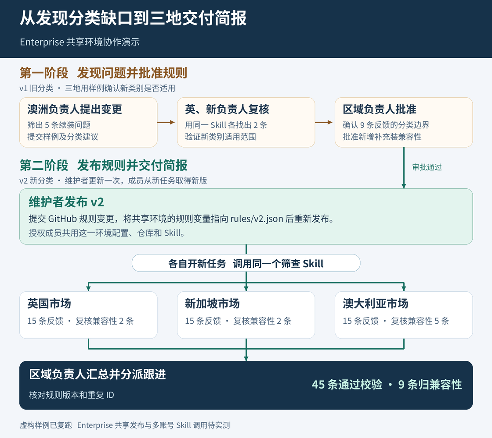

# Enterprise Codex Cloud 协作演示

这个项目用跨市场日化反馈说明，团队怎样通过 **同一套 Codex Cloud 环境和同一个筛查 Skill**，找出旧分类遗漏的问题，审核新规则，再按统一口径汇总。演示包含 **45 条虚构用户反馈，英国、新加坡和澳大利亚各 15 条**。

[下载 Excel 演示数据](https://raw.githubusercontent.com/peterljlj/market-feedback-cloud-demo/main/samples/market-feedback.xlsx) · [Enterprise 发布配置](docs/setup.md) · [实测与验收报告](docs/validation.md)

[下载 Codex 实操录制手册（Word）](https://raw.githubusercontent.com/peterljlj/market-feedback-cloud-demo/main/docs/demo/codex-cloud-recording-guide.docx) · [下载详细汇报 PPT](https://raw.githubusercontent.com/peterljlj/market-feedback-cloud-demo/main/docs/demo/enterprise-cloud-collaboration.pptx)

现场演示由两段真实 Codex 操作组成。第一段用澳洲样例发现 v1 的分类缺口、启用已有 v2，并发出更新通知。第二段用新加坡样例接收通知，两次运行同一筛查命令，展示切换到 v2 后自动识别的标签不匹配。**演示者负责环境配置和维护。澳洲与新加坡负责人是两个账号在录制中模拟的业务角色。** PPT 展示正式的 Enterprise 共享方案。

**当前成果。** 两个真实账号已分别配置环境、连接同一个 GitHub 仓库并成功复跑前一版。它证明人员可以共用仓库协作，每个账号仍需分别配置环境。当前扩展版的 Excel、筛查 Skill、代码和 Enterprise 配置已做好并运行仓库检查。**Enterprise 的共享发布及 Skill 的跨账号调用待在目标工作区验证。**

## 三个市场在合作做什么

假设一家日化快消品牌同时销售带香味的瓶装洗护产品和补充装。顾客用完后可保留原瓶，用匹配的补充装续装。三地客服或市场同事每周收集使用和购买反馈，当地负责人复核标签，再交区域负责人形成一份简报。区域例会用它决定问题该交给产品质量、渠道还是库存团队。

| 市场与输入 | 本轮 15 条反馈包含什么 | 各地要交付什么 |
| --- | --- | --- |
| 英国 · [旧标注](samples/uk.csv) / [复核版](samples/uk-revised.csv) | 一般包装、香味、当地门店买不到，以及 2 条续装问题：喷嘴太窄无法密封，补充装卡扣锁不住 | 用同一 Skill 复核 2 条续装问题。门店线索另交渠道团队核对 |
| 新加坡 · [旧标注](samples/sg.csv) / [复核版](samples/sg-revised.csv) | 一般包装、中英文香味评价、补充装售罄，以及 2 条续装问题：接头装不进原瓶、接口无法密封 | 用同一 Skill 复核中英文反馈。售罄线索另交库存团队按渠道、SKU 和日期核对 |
| 澳大利亚 · [旧标注 CSV](samples/au.csv) | 一般包装、香味和购买反馈，以及 5 条与原瓶配合有关的装入、接合和密封问题 | 梳理共同症状、发起新增类别提议，审批后提交[复核版 CSV](samples/au-revised.csv) |

旧分类把补充装接口问题和瓶盖破损都归到「一般包装」，区域简报无法单独统计装不上或密封不了的情况。产品团队需要看到**是哪一种续装故障**，才能进一步核对瓶型、补充装型号与批次。补充装售罄则归「购买可得性」，仍由当地库存人员核实。样例记录的是顾客反馈，库存数量需另查业务系统。

## 同一个 Skill 怎样发现问题

三地使用仓库里的 [`check-market-feedback` Skill](.agents/skills/check-market-feedback/SKILL.md)。它先运行筛查脚本，从原文找「补充装」和装不上、尺寸不合、接不上、无法密封等组合线索，再把反馈 ID、旧标签、命中的词和建议类别交给人复核。

| 筛查发现 | 何时出现 | 谁接手 |
| --- | --- | --- |
| `COVERAGE_GAP` · 类别未覆盖 | 旧规则没有「补充装兼容性」，同一 Skill 在三地 45 条旧标注中检出 9 条候选。澳洲 5 条，英国和新加坡各 2 条。 | 澳洲负责人先提出分类提议，英、新负责人用本地样例验证适用性 |
| `LABEL_MISMATCH` · 已有类别但旧标签不一致 | 用 v2 检查相同批次，仍提示这 9 条。新类别已经存在，原记录仍标为「一般包装」。 | 三地负责人按批准口径分别复核，再提交各自的修订表 |

Excel 的「区域汇总」和三个市场页可以查看或筛选这 45 条记录。每个市场页同时展示旧标签、筛查线索和复核后标签。脚本读取同源 CSV。筛查规则针对本次续装案例，结果是待复核线索。新加坡的「补充装售罄」仍归购买可得性，澳洲的「原瓶未开封就漏液」仍归一般包装。

## 谁发现问题，谁推动 v2

1. **澳洲市场负责人发现并申请。** 同一批反馈里的 AU-01、AU-02、AU-04、AU-05、AU-06 被 Skill 标出。澳洲负责人核对原文后，提交 5 个反馈 ID、当前标签、建议类别及例外边界。
2. **英国和新加坡负责人用本地反馈复核。** 用同一个 Skill 各找出 2 条同类记录，英国是 UK-05、UK-13，新加坡是 SG-05、SG-13。三地用不同措辞描述了相近的问题，新加坡样例还覆盖中文反馈。
3. **区域负责人批准业务口径。** 审核三地案例以及兼容性与购买可得性的边界。批准后，三地负责人各自复核，只更新本地命中的标签并保留原文和旧表。
4. **环境维护者负责发布。** 将批准的规则和样例提交 GitHub、运行回归检查，再更新并重新发布同一个共享环境。区域负责人最后用同一规则汇总，分派当地渠道、库存与产品质量跟进。

**v1 和 v2 是分类规则版本。** [v1](rules/v1.json) 包含一般包装、香味、购买可得性；[v2](rules/v2.json) 新增补充装兼容性。两份规则文件保留在同一个 GitHub 仓库。旧的环境配置指向 `rules/v1.json`；维护者把同一个命名环境的 `FEEDBACK_RULES_FILE` 改为 `rules/v2.json` 后重新发布，新任务继承新版。规则版本、Git 提交、Codex 环境发布版本分别记录。

## 用两个账号录制一次规则更新接力

录制前让两个账号都连接本仓库的 `main`。首次创建或自动准备建议提前完成，视频从已经可用的环境开始。两版规则和脚本均已在仓库里。对每个市场，两次使用相同的命令和旧 CSV，只改变任务继承的分类规则。

| 视频与出镜身份 | 真实操作 | 镜头停留处 |
| --- | --- | --- |
| **视频一 · 账号 A**。先模拟澳洲负责人，再以环境维护者身份操作 | 用生效的 v1 筛查 `samples/au.csv`。将 `FEEDBACK_RULES_FILE` 从 `rules/v1.json` 改为 `rules/v2.json`，重新发布并开新任务，再运行同一条 `python3 feedback_review.py samples/au.csv`。 | 两次各扫描 15 条。屏幕上五条 `COVERAGE_GAP` 变为五条 `LABEL_MISMATCH`。以维护者身份发出更新通知。 |
| **视频二 · 账号 B**。模拟新加坡负责人 | 从 B 自己的 v1 环境开任务，运行 `python3 feedback_review.py samples/sg.csv`。收到通知后，将 B 的环境切到 v2，重新发布并开新任务。再次运行同一条命令，继续读取原始 `samples/sg.csv`。 | 两次各扫描 15 条。脚本自动找出同两条记录，提示从 `COVERAGE_GAP` 变为 `LABEL_MISMATCH`，并给出建议标签及匹配到的原文。以市场负责人身份回报发现。 |

**两段用一条通知衔接。** 例如「市场反馈分类已更新到 `rules/v2.json`。请新加坡在新任务中对同一份原表重新运行筛查，回报规则版本、命中记录和建议标签。」录制保留原始 CSV，已复核的 `*-revised.csv` 用于后续业务校验。

**在哪里看结果。** `feedback_review.py` 将识别结果输出到 JSON 的 `flags` 字段。`feedback_check.py` 统计 CSV 已有的标签，因此用 v2 直接校验旧表时，兼容性计数仍为 0。录制以筛查日志中的 `rule_version` 和 `flags` 为证据。

这两段展示现有账号如何用同一仓库接力。**当前两个账号各自维护环境配置；Enterprise 方案由维护者重新发布一次，成员各自从同一个共享环境开新任务。** [逐步操作与可复制提示词（Word）](https://raw.githubusercontent.com/peterljlj/market-feedback-cloud-demo/main/docs/demo/codex-cloud-recording-guide.docx)

## Enterprise 如何用同一个环境和 Skill



上半部分说明谁提议、谁复核、谁批准。下半部分说明维护者如何把新版规则交付给三个独立的市场任务，以及区域负责人如何汇总。

1. 管理员授权成员使用 Codex Cloud，并授权维护者管理共享环境。
2. 维护者在目标工作区创建 `market-feedback-pilot`，选本仓库，设置规则变量。在 **Privacy → Who can use** 选择工作区并发布。
3. 三地成员从环境选择器选择同一已发布环境，各开自己的 Codex 任务。任务从共同仓库取得相同的 Skill 和脚本。在支持项目 Skill 的客户端分别调用 `check-market-feedback`，输入本市场 CSV。成员可以共用配置、规则和 Skill；聊天与任务文件各自独立。
4. A、B 从同一已发布环境各开新任务，直接运行 `python3 scripts/check_team_cloud_environment.py`。核对 Git 提交、规则指纹和结果，再实际调用 Skill，记录各账号能否发现并运行它。当前已验证的是 Skill 调用的脚本，Enterprise 中的发现和多人调用待实测。[详细设置、发布与回退](docs/setup.md)

## 看结果或现场复跑

| v2 审核后的区域简报 | 一般包装 | 香味 | 购买可得性 | 补充装兼容性 | 合计 |
| --- | ---: | ---: | ---: | ---: | ---: |
| 英国 | 3 | 5 | 5 | 2 | 15 |
| 新加坡 | 3 | 5 | 5 | 2 | 15 |
| 澳大利亚 | 3 | 4 | 3 | 5 | 15 |
| **合计** | **9** | **14** | **13** | **9** | **45** |

在仓库根目录先筛查旧标注，再验收复核后的三地样例：

```sh
python3 feedback_review.py --rules rules/v1.json samples/uk.csv samples/sg.csv samples/au.csv
python3 scripts/check_team_cloud_environment.py --prepare
```

第一条输出 9 条待复核的类别缺口。第二条检查 v2 汇总、三地输入指纹和复核后是否还有提示。这组样例验证了澳洲提出的规则可以在三地共用。`--prepare` 用于复跑仓库。正式验收已发布环境时，直接运行验收命令读取任务的实际配置。[实跑证据](docs/evidence/demo-run.json) · [角色与发布验收报告](docs/validation.md)
